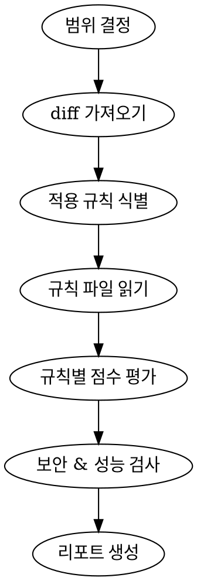

# 코드 리뷰

## 개요

git 변경사항에 대한 체계적인 코드 리뷰. 점수 시스템을 사용하며, 변경된 파일에 해당하는 규칙만 평가합니다.

## 사용 시점

- "현재 브랜치 코드리뷰 해줘"
- "커밋 abc123부터 def456까지 리뷰해줘"

## 프로세스 흐름



## 1단계: 범위 결정

**옵션 A - 현재 브랜치 vs main (기본):**

```bash
git diff main...HEAD --stat
git diff main...HEAD
```

**옵션 B - 특정 커밋 범위:**

```bash
git log --oneline <시작>..<끝>
git diff <시작>..<끝>
```

**변경사항 없음?** diff가 비어있으면 사용자에게 알리고 명확한 범위를 요청합니다.

## 2단계: 적용 규칙 식별

**변경된 파일에 해당하는 규칙만 평가합니다.**

| 변경된 파일                    | 적용 규칙                    |
| ------------------------------ | ---------------------------- |
| `*.tsx`, `*.ts`                | `typescript.md`, `nextjs.md` |
| `*.scss`                       | `scss.md`                    |
| `*.css`, `className=`          | `tailwind.md`                |
| 커밋 메시지                    | `git.md` (항상 적용)         |
| `useQuery`, `useMutation`      | `tanstack-query.md`          |
| `create`, `useStore`           | `zustand.md`                 |
| `z.object`, `z.string`         | `zod.md`                     |
| `useTranslations`, `messages/` | `next-intl.md`               |

**예시:** `.scss` 파일만 변경됨 → `scss.md`와 `git.md`만 평가.

## 3단계: 규칙 읽기 & 평가

**반드시 실제 규칙 파일을 읽어야 합니다. 빠른 참조만 보면 안 됩니다.**

```bash
# 적용 규칙 파일 읽기
cat .claude/rules/typescript.md
cat .claude/rules/nextjs.md
# ... 등
```

### 점수 체계 (적용 규칙당 10점)

| 점수 | 의미                       |
| ---- | -------------------------- |
| 10   | 완벽한 준수                |
| 7-9  | 경미한 이슈 (🟢 낮은 위험) |
| 4-6  | 다수의 위반 (🟡 중간 위험) |
| 1-3  | 주요 위반 (🟠 높은 위험)   |
| 0    | 치명적 실패 (🔴 심각 위험) |

### 위험도 수준

| 아이콘 | 수준 | 설명                               |
| ------ | ---- | ---------------------------------- |
| 🔴     | 심각 | 보안, 데이터 손실, 브레이킹 체인지 |
| 🟠     | 높음 | 주요 기능, 성능 문제               |
| 🟡     | 중간 | 코드 품질, 유지보수성              |
| 🟢     | 낮음 | 스타일, 컨벤션                     |

### 빠른 참조 (전체 내용은 실제 규칙 파일 참조)

| 규칙                  | 기본 위험도 | 주요 영역                                  |
| --------------------- | ----------- | ------------------------------------------ |
| **typescript.md**     | 🟡          | `type` vs `interface`, 네이밍, `any` 금지  |
| **nextjs.md**         | 🟠          | Server Component, async params, Image/Link |
| **scss.md**           | 🟢          | BEM, z-index 변수, Mobile-first            |
| **tailwind.md**       | 🟢          | CSS 변수, 반응형 순서, 다크모드            |
| **git.md**            | 🟢          | `type(scope): Subject`, 대문자, 명령형     |
| **tanstack-query.md** | 🟠          | queryKey, staleTime, 에러/로딩 처리        |
| **zustand.md**        | 🟡          | 슬라이스 패턴, 미들웨어                    |
| **zod.md**            | 🟠          | `*Schema` 네이밍, `z.infer`, 에러 메시지   |
| **next-intl.md**      | 🟡          | `useTranslations`, 메시지 구조             |

## 4단계: 보안 & 성능

| 영역     | 검사 항목                              |
| -------- | -------------------------------------- |
| **보안** | 입력 검증, 인젝션 위험, 시크릿 노출    |
| **성능** | N+1 쿼리, 불필요한 리렌더링, 번들 크기 |

## 5단계: 리포트 생성

### 종합 점수 계산

**종합 = 적용 규칙 점수 합계 / (적용 규칙 수 × 10) × 100**

| 등급 | 백분율  |
| ---- | ------- |
| A+   | 96-100% |
| A    | 90-95%  |
| B    | 80-89%  |
| C    | 70-79%  |
| D    | 60-69%  |
| F    | < 60%   |

### 리포트 템플릿

```markdown
# 코드 리뷰 리포트

**범위**: [브랜치명 또는 커밋 범위]
**변경된 파일**: [개수]
**날짜**: [YYYY-MM-DD]

---

## 종합 점수: [XX]% (등급: [A+/A/B/C/D/F])

### 적용된 규칙 ([N]개 규칙 평가)

| 규칙     | 점수 | 위험도   | 이슈   |
| -------- | ---- | -------- | ------ |
| [규칙명] | /10  | [아이콘] | [설명] |
| ...      | ...  | ...      | ...    |

**해당 없음:** [변경사항에 적용되지 않는 규칙 목록]

---

## 위험도별 발견사항

### 🔴 심각

- [없음 또는 목록]

### 🟠 높음

- [없음 또는 목록]

### 🟡 중간

- [없음 또는 목록]

### 🟢 낮음

- [없음 또는 목록]

---

## 보안

- [우려사항 또는 "이슈 없음"]

## 성능

- [우려사항 또는 "이슈 없음"]

---

## 권장사항

1. **[필수 수정]** - [설명]
2. **[수정 권장]** - [설명]
3. **[개선 권장]** - [설명]
```

## 흔한 실수

| 실수                               | 해결                                |
| ---------------------------------- | ----------------------------------- |
| 해당 없는 규칙에 점수 부여         | 변경된 파일에 맞는 규칙만 점수 부여 |
| 빠른 참조만 보고 체크리스트로 사용 | 실제 `.claude/rules/*.md` 파일 읽기 |
| 위험도 평가 누락                   | 모든 발견사항에 위험도 수준 표시    |
| 점수 근거 없음                     | 이슈 열에 감점 사유 설명            |
