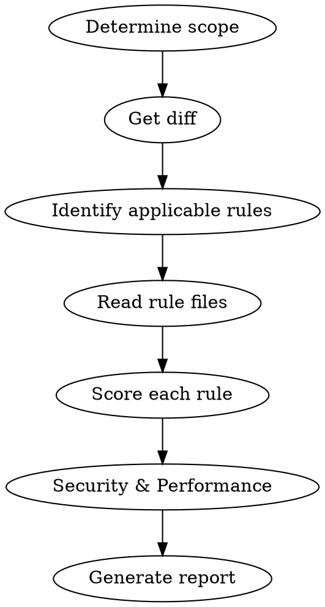

# Reviewing Code

## Overview

Systematic code review for git changes with scoring system. Only reviews rules applicable to changed files.

## When to Use

- "현재 브랜치 코드리뷰 해줘"
- "커밋 abc123부터 def456까지 리뷰해줘"

## Process Flow



## Step 1: Determine Scope

**Option A - Current branch vs main (default):**

```bash
git diff main...HEAD --stat
git diff main...HEAD
```

**Option B - Specific commit range:**

```bash
git log --oneline <start>..<end>
git diff <start>..<end>
```

**No changes?** If diff is empty, inform user and ask for clarification.

## Step 2: Identify Applicable Rules

**Only evaluate rules that apply to changed files.**

| Changed Files                  | Applicable Rules             |
| ------------------------------ | ---------------------------- |
| `*.tsx`, `*.ts`                | `typescript.md`, `nextjs.md` |
| `*.scss`                       | `scss.md`                    |
| `*.css`, `className=`          | `tailwind.md`                |
| Commit messages                | `git.md` (always applies)    |
| `useQuery`, `useMutation`      | `tanstack-query.md`          |
| `create`, `useStore`           | `zustand.md`                 |
| `z.object`, `z.string`         | `zod.md`                     |
| `useTranslations`, `messages/` | `next-intl.md`               |

**Example:** If only `.scss` files changed → evaluate `scss.md` and `git.md` only.

## Step 3: Read & Evaluate Rules

**MUST read the actual rule files, not just Key Checks.**

```bash
# Read applicable rule files
cat .claude/rules/typescript.md
cat .claude/rules/nextjs.md
# ... etc
```

### Scoring (10 points per applicable rule)

| Score | Meaning                              |
| ----- | ------------------------------------ |
| 10    | Perfect compliance                   |
| 7-9   | Minor issues (🟢 Low risk)           |
| 4-6   | Multiple violations (🟡 Medium risk) |
| 1-3   | Major violations (🟠 High risk)      |
| 0     | Critical failure (🔴 Critical risk)  |

### Risk Levels

| Icon | Level    | Description                           |
| ---- | -------- | ------------------------------------- |
| 🔴   | Critical | Security, data loss, breaking changes |
| 🟠   | High     | Major functionality, performance      |
| 🟡   | Medium   | Code quality, maintainability         |
| 🟢   | Low      | Style, conventions                    |

### Quick Reference (Read actual rules for full details)

| Rule                  | Default Risk | Key Areas                                  |
| --------------------- | ------------ | ------------------------------------------ |
| **typescript.md**     | 🟡           | `type` vs `interface`, naming, `any` 금지  |
| **nextjs.md**         | 🟠           | Server Component, async params, Image/Link |
| **scss.md**           | 🟢           | BEM, z-index 변수, Mobile-first            |
| **tailwind.md**       | 🟢           | CSS 변수, 반응형 순서, 다크모드            |
| **git.md**            | 🟢           | `type(scope): Subject`, 대문자, 명령형     |
| **tanstack-query.md** | 🟠           | queryKey, staleTime, 에러/로딩 처리        |
| **zustand.md**        | 🟡           | 슬라이스 패턴, 미들웨어                    |
| **zod.md**            | 🟠           | `*Schema` 네이밍, `z.infer`, 에러 메시지   |
| **next-intl.md**      | 🟡           | `useTranslations`, 메시지 구조             |

## Step 4: Security & Performance

| Area            | Check                                               |
| --------------- | --------------------------------------------------- |
| **Security**    | Input validation, injection risks, secrets exposure |
| **Performance** | N+1 queries, unnecessary re-renders, large bundles  |

## Step 5: Generate Report

### Total Score Calculation

**Total = Sum of applicable rule scores / (Applicable rules × 10) × 100**

| Grade | Percentage |
| ----- | ---------- |
| A+    | 96-100%    |
| A     | 90-95%     |
| B     | 80-89%     |
| C     | 70-79%     |
| D     | 60-69%     |
| F     | < 60%      |

### Report Template

```markdown
# Code Review Report

**Scope**: [branch name or commit range]
**Files changed**: [count]
**Date**: [YYYY-MM-DD]

---

## Total Score: [XX]% (Grade: [A+/A/B/C/D/F])

### Applicable Rules ([N] rules evaluated)

| Rule        | Score | Risk   | Issues        |
| ----------- | ----- | ------ | ------------- |
| [rule name] | /10   | [icon] | [description] |
| ...         | ...   | ...    | ...           |

**Not Applicable:** [list rules that don't apply to changes]

---

## Findings by Risk Level

### 🔴 Critical

- [None or list]

### 🟠 High

- [None or list]

### 🟡 Medium

- [None or list]

### 🟢 Low

- [None or list]

---

## Security

- [Any concerns or "No issues found"]

## Performance

- [Any concerns or "No issues found"]

---

## Recommendations

1. **[Must Fix]** - [description]
2. **[Should Fix]** - [description]
3. **[Nice to Have]** - [description]
```

## Common Mistakes

| Mistake                                | Fix                                     |
| -------------------------------------- | --------------------------------------- |
| Scoring rules that don't apply         | Only score rules matching changed files |
| Using Key Checks as complete checklist | Read actual `.claude/rules/*.md` files  |
| Missing risk assessment                | Every finding needs a risk level        |
| No score justification                 | Explain deductions in Issues column     |
